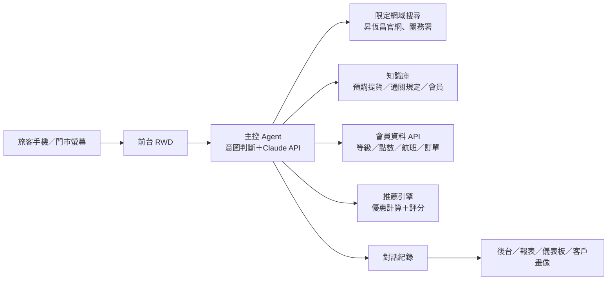
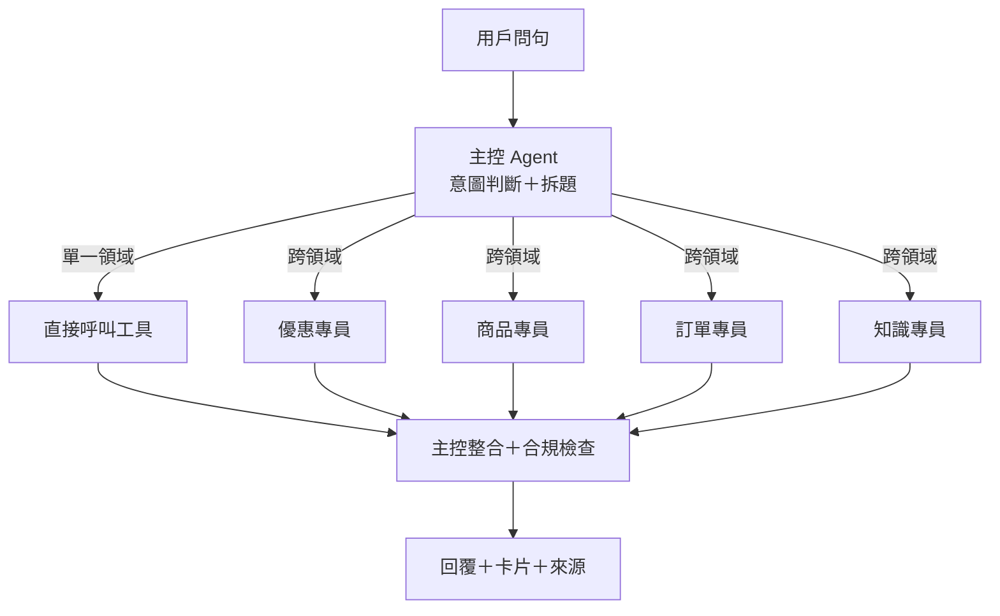

# 昇恆昌 AI 購物小幫手 產品規劃文件（PRD）

2026-10-14 · Xander

## 產品概述

昇恆昌 AI 購物小幫手以「這趟怎麼買最划算」和「送禮挑選」為核心，手機優先，一個機器人同時服務免稅店（機場、市區預購、免稅購物網預購）與宅配網兩個通路，架構可延伸到機場與市區門市的大螢幕。

**背景**：旅客出國前時間有限，面對品牌、活動、會員權益與通關規定（菸酒額度、液體、提貨文件）很難一次弄清楚；門市與客服人員重複回答相同問題。活動多、檔期短，「出發那天活動還在不在」常常是客訴來源。

**目標**

1. 依會員等級、近 6 個月消費與出發日，算出這次最划算的 3 個優惠，附可折金額與理由。
2. 商品選購可以一問一答（預算、品牌或香調、送禮對象），或依會員常買品牌直接推薦。
3. 每個答案標示出自官網哪一頁，並可產出比較表帶去機場。
4. 預購單、提貨與規定類問題自助回答，複雜問題（客訴、退貨退款）轉真人。

**成功指標（正式上線後）**

| 指標 | 定義 | 建議目標 |
| --- | --- | --- |
| 來源標示率 | 價格、優惠與規定類回答附至少一個官網來源 | 100% |
| 首字回應時間 P95 | 送出問題到出現第一個字 | ≤ 3 秒 |
| 讚率 | 讚 ÷（讚＋倒讚） | ≥ 80% |
| 推薦採用率 | 看到推薦後點開商品、產出比較表或進入預購的比例 | ≥ 30% |
| 預購轉換 | 對話後 7 天內完成免稅購物網預購的比例 | 與業主確認 |
| 轉真人率 | 需要轉真人的對話比例 | ≤ 15% |

目標值為初版建議，需與業主確認。

## 一個機器人、兩個通路

| 項目 | 免稅店 | 宅配網 |
| --- | --- | --- |
| 購買方式 | 機場、市區預購、免稅購物網預購（出境前 45 天開放） | 線上下單，宅配到家 |
| 價格 | 免稅價 | 宅配價（含稅） |
| 需要 | 護照、登機證、提貨聯 | 收件資料 |
| 限制 | 入境菸酒與行李免稅額度 | 酒類等商品依上架為準 |
| 共用 | RICHCLUB 會員、點數、對話紀錄、客戶畫像 | 同左 |

客人說了出發日、航班或機場就走免稅店；說寄到家或不出國就走宅配網；沒說時先用免稅店回答，並提醒也可以宅配到家。

## 目標用戶與使用情境

| 情境 | 用戶 | 觸發問法 | 系統行為 |
| --- | --- | --- | --- |
| 個人化優惠 | 會員 | 「這次出國怎麼買最划算？」 | 驗證 → 讀取等級、消費、出發日 → 推薦 3 個優惠加可折金額 |
| 商品查詢 | 任何人 | 「3,000 以內送長輩的伴手禮？」 | 查商品 → 回答附來源 |
| 送禮選購 | 任何人 | 「想買香水送女朋友」 | 一問一答收斂條件 → 推薦 3 件 → 套用優惠價 |
| 預購單疑問 | 會員 | 「預購單怎麼沒有折 1,000？」 | 驗證 → 讀取訂單 → 說明門檻與不列入計算的商品 |
| 規定問答 | 任何人 | 「入境可以帶幾瓶酒？」 | 知識庫（關務署規定）→ 回答附來源 |
| 轉真人 | 任何人 | 客訴、退貨退款或連續答不出 | 帶對話摘要轉客服 |

## 系統架構與技術選型

主控 agent 用 Claude API 判斷意圖，再依資料性質分流。LLM 不計算價格，只負責問答引導與解釋。

**資料分流**

| 資料類型 | 例子 | 處理方式 |
| --- | --- | --- |
| 靜態知識 | 預購提貨、菸酒額度、液體、會員等級 | POC 放在 data/ 由工具讀取；正式版改走 RAG |
| 即時公開資訊 | 最新活動、週年慶、品牌活動 | 限定網域搜尋，回答附來源 |
| 會員資料 | 等級、點數到期日、航班、消費、預購單 | 會員 API（POC 用假資料） |
| 推薦 | 優惠、商品、組合優惠價 | 推薦引擎（程式）計算，LLM 只負責解釋理由 |

**推薦引擎不是 AI 模型**，是寫死規則的程式：先排除不能用的優惠（已過期、出發前就結束、會員等級不符、購物籃沒有適用分類），再依「省下金額、品類符合度、使用門檻」三項打分並依權重加總，排序取前三並算出每個優惠可折多少、還差多少達門檻，最後交給 LLM 講成人話。

**技術選型**

| 層 | POC | 正式版 |
| --- | --- | --- |
| LLM | Claude API：主控 claude-sonnet-5、專員 claude-haiku-4-5-20251001 | 依任務分流不同等級模型 |
| 搜尋 | Claude web search，allowed_domains 限定昇恆昌官網與關務署頁面 | 同左，加上定期爬取官網進知識庫 |
| 知識庫 | data/ 下的 JSON 與 Markdown | PostgreSQL＋pgvector |
| 會員與訂單 | 假資料 | RICHCLUB 會員系統、預購與宅配訂單 API |
| 前台 | Vite＋React＋Tailwind，手機優先 | 同左，可嵌入 App 與官網 |
| 後端 | Node.js＋Express＋TypeScript | 同左，部署雲端 |

## Agent 與工具設計

主控 agent 用 function calling 處理所有問題；只有跨領域的複合問題才拆給專員 agent 平行處理，最後由主控整合回答。

**Agent 分工**

| Agent | 職責 | 可用工具 | 模型 |
| --- | --- | --- | --- |
| 主控 | 意圖判斷、追問條件、拆題派工、整合回答、合規檢查 | 全部工具＋派工 | claude-sonnet-5 |
| 優惠專員 | 這次最划算的優惠 | query_promos、get_purchases、recommend_promos、search_official_web | claude-haiku-4-5-20251001 |
| 商品專員 | 商品推薦與優惠價 | query_products、recommend_products、get_promo_price、search_official_web | claude-haiku-4-5-20251001 |
| 訂單專員 | 預購單、會員資料 | get_order、get_user_profile | claude-haiku-4-5-20251001 |
| 知識專員 | 預購提貨、通關規定、最新活動 | search_kb、search_official_web | claude-haiku-4-5-20251001 |

**工具清單（function calling）**

| 工具 | 用途 | 主要輸入 | 輸出 | 需驗證 |
| --- | --- | --- | --- | --- |
| verify_identity | 會員手機與 OTP 驗證 | 手機號碼、驗證碼 | 驗證狀態、user_id | — |
| get_user_profile | 會員資料 | — | 等級、點數與到期日、下一趟航班、預購開放日、常買商品 | 是 |
| get_purchases | 近期消費 | 月數 | 每月免稅店／宅配網消費、出國次數、常買分類 | 是 |
| get_order | 訂單明細 | 訂單編號 | 商品、折扣、實付、提貨資訊、滿額門檻檢查 | 是 |
| query_promos | 篩選優惠 | 通路、分類、類型、等級、日期 | 活動清單 | 否 |
| recommend_promos | 計算最划算的優惠 | 已驗證自動讀取，或手動預算與分類 | 前 3 名、可折金額、還差多少、排除原因 | 否 |
| query_products | 篩選商品 | 品牌、分類、價格、標籤、通路 | 商品清單 | 否 |
| recommend_products | 推薦商品 | 預算、分類、標籤、品牌、通路 | 前 3 名與理由 | 否 |
| get_promo_price | 商品套用優惠的價格 | 商品、優惠、通路 | 原價、優惠價、省下金額 | 否 |
| search_kb | 查規定與 FAQ | 問題 | 內容片段與來源 | 否 |
| search_official_web | 限定官網搜尋 | 問題 | 答案、引用原文、網址 | 否 |
| generate_comparison | 產出比較表 | 優惠、商品或組合 | 比較表連結、QR code | 否 |
| handoff_to_human | 轉真人客服 | 對話摘要 | 工單編號 | 否 |

**防護規則**

1. 價格、折扣、省下金額與結帳價只能來自工具回傳，LLM 不自行計算。
2. 商品、優惠與規定類回答至少附一個來源，沒有來源就不回答。
3. 會員資料工具必須在已驗證狀態下才能呼叫。
4. 每輪最多 6 次工具呼叫、最多 3 個專員 agent，專員逾時 15 秒就用已取得的結果回答。
5. 只回答昇恆昌相關問題，不比較或評論其他免稅店或購物平台。
6. 菸酒相關回答一律提醒入境免稅數量，不推銷菸品。

## 完整使用者情境

| 編號 | 情境 | 需驗證 | 模式 |
| --- | --- | --- | --- |
| S1 | 一般商品與優惠查詢 | 否 | 單一 agent |
| S2 | 個人化優惠推薦 | 是 | 單一 agent |
| S3 | 出發日與點數到期時間差 | 是 | 單一 agent |
| S4 | 商品選購一問一答 | 否 | 單一 agent |
| S5 | 會員個人化選購 | 是 | 單一 agent |
| S6 | 預購單與訂單疑問 | 是 | 單一 agent |
| S7 | 出國購物一次規劃（商品＋優惠＋取貨） | 是 | Multi-agent |
| S8 | 規定與服務問答 | 否 | 單一 agent |
| S9 | 答不出／轉真人 | 否 | 單一 agent |
| S10 | 超出範圍的問題 | 否 | 單一 agent |

### S1 一般商品與優惠查詢

- **用戶說**：「預算 3,000 以內有什麼適合送長輩的伴手禮？」「現在免稅店有什麼優惠活動？」
- **流程**：query_products／recommend_products 或 query_promos → 整合回答。沒說通路時用免稅店回答，提醒也可以宅配到家。
- **例外**：沒有符合條件的商品 → 顯示最接近的 2 件並說明差在哪裡。

### S2 個人化優惠推薦

- **用戶說**：「這次出國怎麼買最划算？」
- **流程**：引導驗證 → recommend_promos（自動讀取會員等級、常買分類、每趟平均消費、出發日）→ 整合回答。
- **畫面**：消費摘要（「你是創造者，每趟平均約 10,333 元，常買美妝」）→ 3 張優惠卡片，標示可折金額 → 提醒出發前就結束的活動。
- **例外**：用戶不想驗證 → 改問這次的預算與想買的分類，用 manual_basket 推薦。

### S3 出發日與點數到期時間差

- **用戶說**：「我 12 月才出國，點數會不會先過期？現在的優惠到時候還能用嗎？」
- **流程**：get_user_profile、recommend_promos → 引擎回報點數在出發前到期、預購開放日（出發前 45 天）、出發時已結束的活動。
- **畫面**：先講點數到期日與剩幾天 → 列出用不到的活動 → 建議先在宅配網或近期用點數折抵。

### S4 商品選購一問一答

- **用戶說**：「想買香水送女朋友」
- **流程**：條件不足 → 最多追問 3 題（預算、香調或品牌、送禮對象），每題附點選按鈕 → recommend_products → get_promo_price。
- **畫面**：3 件商品卡片（免稅價、優惠價、推薦理由），可左右滑動。

### S5 會員個人化選購

- **用戶說**：「幫我看這次可以買什麼」（已驗證）
- **流程**：get_user_profile 取得會員等級、下一趟航班與常買品牌 → 只追問預算 → recommend_products（優先常買品牌、排除已買過的那一件）→ get_promo_price。

### S6 預購單與訂單疑問

- **用戶說**：「我的預購單怎麼沒有折 1,000？」
- **流程**：驗證 → get_order → 引擎檢查滿額活動的適用金額（排除分類不列入）與還差多少 → 必要時 search_kb 補提貨規定。
- **畫面**：「實付 7,692 元；週年慶只計算非酒類 5,880 元，還差 4,120 元」→ 訂單明細卡片。
- **例外**：退貨退款或客訴 → 轉真人（S9）。

### S7 出國購物一次規劃（展示主秀）

- **用戶說**：「我下週五從桃園飛東京，想預購一瓶威士忌跟送媽媽的保養品，預算一萬，現在有什麼優惠？在哪裡取貨？」
- **流程**：
    1. 主控判斷涉及 3 個領域，確認已驗證後拆題。
    2. 平行派工：商品專員推薦威士忌與保養品並查優惠價；優惠專員依預算與分類算最划算的優惠；知識專員查預購提貨與菸酒額度。
    3. 主控整合成 3 組「商品＋優惠」組合，結帳價由 get_promo_price 計算。
    4. 合規檢查：每組都有來源、價格來自工具、提醒酒類 1.5 公升。
- **畫面**：一句結論 → 3 組組合卡片（原價、優惠價、省下金額）→ 提貨方式 → 來源標籤 → 產出比較表與 QR。畫面上顯示「正在挑選商品／計算優惠／查詢提貨規定」的進度。
- **例外**：某個專員逾時 → 先用已完成的結果回答，註明哪一塊稍後補上。

### S8 規定與服務問答

- **用戶說**：「入境可以帶幾瓶酒？」「提貨要帶什麼？」
- **流程**：search_kb → 沒找到或資料超過 30 天未更新 → search_official_web。
- **例外**：知識庫與官網都查不到 → S9。

### S9 答不出／轉真人

- **觸發**：連續 2 次無法回答、用戶說「找真人」、或涉及客訴、退貨退款。
- **流程**：主控整理對話摘要 → handoff_to_human。POC 以模擬工單呈現。

### S10 超出範圍的問題

- **用戶說**：「其他免稅店是不是比較便宜？」或與購物無關的問題。
- **流程**：主控判斷超出範圍，不呼叫工具，禮貌說明並引導回首頁快捷入口。

## POC 資料與檔案結構

| 檔案 | 內容 | 供應工具 |
| --- | --- | --- |
| promos.json | 11 個優惠：類型、通路、門檻、折扣、適用分類、會員等級、期間、官網網址 | query_promos、recommend_promos |
| products.json | 20 件商品：品牌、分類、免稅價、宅配價、標籤 | query_products、recommend_products |
| bundles.json | 商品套用優惠的組合優惠價 | get_promo_price |
| users_mock.json | 3 位展示會員：等級、點數、下一趟航班、6 個月消費、訂單 | verify_identity、get_user_profile、get_purchases、get_order |
| kb.md | 預購提貨、通關規定、會員、宅配網 FAQ，每段附來源 | search_kb |
| eval.json | 30 題標準問答，涵蓋 S1–S10 | 展示前回歸測試 |

展示會員設計：會員 A 創造者、常買美妝、11/8 出發（S2：週年慶出發前結束）；會員 B 探索者、12/20 出發、點數 10/31 到期（S3）；會員 C 領航者、10/23 出發、有含酒類的待取貨預購單（S5、S6、S7）。

## 前台功能（手機優先 RWD）

| 頁面 | 主要元件 | 說明 |
| --- | --- | --- |
| 首頁 | 4 個快捷入口、輸入框 | 優惠活動、商品推薦、我的預購單、免稅規定 |
| 對話頁 | 串流回覆、結果卡片、來源標籤 | 卡片可左右滑動；來源標籤點開看引用原文與網址 |
| 會員驗證 | 會員手機號碼、OTP | POC 使用固定驗證碼 123456 |
| 比較表 | 商品或優惠並排、來源註腳 | 列印 PDF、分享連結、QR code，帶去機場 |

## 後台功能

| 模組 | 功能 |
| --- | --- |
| 商品與知識 | 優惠活動、商品、組合優惠價的新增修改、上下架、期間；FAQ 維護 |
| 搜尋來源 | 網域白名單、限定路徑、啟用停用、測試搜尋 |
| Prompt 與情境 | 系統 prompt 版本、差異比對、一鍵回滾；S1–S10 情境設定 |
| 推薦規則 | 權重（省下金額、品類符合度、使用門檻）與排序試算 |
| 對話紀錄 | 查詢、個資遮罩、標註錯誤回答、匯出 |
| 行銷 | 客戶畫像、分眾與名單（只列同意行銷者）、NBA 規則 |
| 儀表板 | 對話數、熱門意圖、推薦優惠分布、零搜尋回答比例、成本 |

## 風險、合規與待確認事項

| 風險 | 影響 | 對策 |
| --- | --- | --- |
| 模型憑記憶回答價格或活動 | 資訊錯誤、客訴 | 價格與活動必查工具；監控零搜尋比例 |
| 出發日活動已結束 | 旅客到機場才發現用不到 | 引擎以出發日判斷活動是否有效 |
| 菸酒超量 | 旅客被罰 | 酒類回答一律提醒入境額度 |
| 公共螢幕個資外洩 | 合規風險 | OTP、遮罩、session 逾時、結果用 QR 帶走 |

**合規**：讀取會員資料前依個資法告知並取得同意；推薦結果標註「實際價格與活動以昇恆昌公告為準」；行銷名單只列同意行銷的會員。

**待確認事項**

- [ ] 實際商品價格、活動門檻與折數（目前為展示假資料）
- [ ] 預購截止時間、退換貨規定、點數效期與折抵比例
- [ ] 是否串接 RICHCLUB 會員與預購訂單 API
- [ ] 官網要納入白名單的頁面路徑
